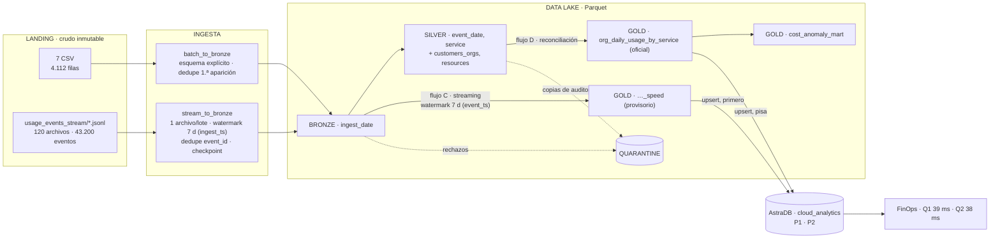

# Diagrama de arquitectura — v2

**Versión**: 2.0 · **Fecha**: 2026-11-13 · **Estado**: implementado y verificado (2.ª entrega)

Imagen: `diagrama_arquitectura_v2.svg` / `.png`. Representa **solo lo que corre**.
Lo previsto para la entrega final aparece en un recuadro gris punteado rotulado
"no implementado", según el criterio de aceptación de la consigna (§6.4): "el
diagrama representa lo implementado y no componentes meramente aspiracionales".

## Vista general

## Qué cambió respecto de la v1

| v1 (propuesta, 20/09) | v2 (implementada, 13/11) | Motivo |
|---|---|---|
| Fuentes → ingesta → Landing | Landing **son** las fuentes; la ingesta lee de ahí | La v1 sugería que la ingesta escribe en Landing, que es inmutable |
| "~20 archivos" de eventos | 120 archivos, 43.200 eventos, sin orden temporal | Dataset completo (D-012) |
| Un watermark de 7 días | Dos: `ingest_ts` para dedupe en Bronze y `event_ts` para la agregación | Con uno solo sobre `event_ts`, Bronze perdía el 87,6% (D-013) |
| Reconciliación "desde Bronze" | Desde Silver, que se recomputa completo desde Bronze | Misma garantía, con la conformación ya aplicada (D-015) |
| La capa rápida escribe sobre Gold | Tabla aparte (`…_speed`); la fusión ocurre en Cassandra, por upsert | Parquet no tiene upsert (D-015) |
| P1 con partición `(org_id, usage_date)` | `((org_id), usage_date, service)` | El rango de fechas es un corte contiguo (D-017) |
| P2 con clustering por costo | Clustering por `rank` | Con el costo en la clave, el upsert no es idempotente (D-017) |
| Cinco marts y tres dominios | Un mart FinOps + anomalías; el resto, marcado como pendiente | Alcance de la 2.ª entrega (§6.2) |
| Capacidades transversales declaradas | Implementadas, cada una con su evidencia | `docs/gobierno.md` |

## Leyenda de trazabilidad

| Elemento | Responde a | Evidencia |
|---|---|---|
| Streaming a Bronze | O4 · consigna §6.2 | `evidence/runs/stream_to_bronze_*` |
| Flujo C (capa rápida) | O1 (latencia mediana ≈ 1 s) | `evidence/runs/gold_stream_*` |
| Flujo D (reconciliación) | Completitud: 36.808 tardíos recuperados | `evidence/runs/gold_job_*` |
| Quarantine | O3 | `evidence/quarantine_muestras.md` |
| Silver v1/v2 | O8 | `tests/test_silver.py` |
| AstraDB P1 y P2 | O5 (parcial), O6 | `evidence/serving/` |
| Doble corrida | O4, O7 | `evidence/idempotencia.md` |
