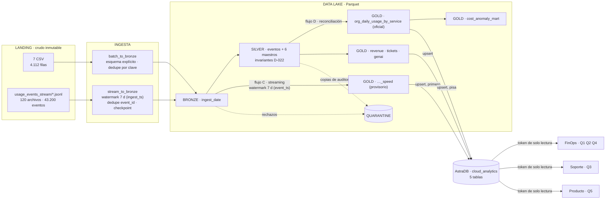

# Diagrama de arquitectura — v3

**Versión**: 3.0 · **Fecha**: 2026-11-18 · **Estado**: implementado y verificado (entrega final)

Imagen: `diagrama_arquitectura_v3.svg` / `.png`. Representa **solo lo que corre**: a
diferencia de la v2, no queda ningún componente "no implementado". Lo que no se hizo
está declarado como límite o como fuera de alcance (README, `docs/backlog_final.md`),
no dibujado como componente (consigna §7.6: "la arquitectura y la documentación
coinciden con el producto real").

## Vista general

## Qué cambió respecto de la v2

| v2 (13/11) | v3 (18/11) | Motivo |
|---|---|---|
| Silver de eventos, `customers_orgs` y `resources` | Además billing, tickets, users y marketing, con invariantes entre columnas | Base de los marts nuevos y O-5 (D-022) |
| Un mart FinOps y anomalías | Cinco marts: suma revenue, tickets y GenAI, con control de grano y de cuadre | Consigna §7.3 (D-023) |
| Dos tablas en AstraDB (Q1, Q2) | Cinco tablas; Q3, Q4 y Q5 con partición de total `'all'` | Consigna §7.4 (D-018, D-024) |
| Consumo solo FinOps | FinOps, Soporte y Producto | Los tres dominios de la consigna (§2.3) |
| Un token de administrador para todo | Administrador para cargar, solo lectura para consultar | Mínimo privilegio (D-025) |
| Recuadro "pendiente · no implementado" | Eliminado: todo lo dibujado corre | Consigna §7.6 |
| 47 tests · variación 0 en 12 tablas | 64 tests · variación 0 en 23 tablas | `evidence/idempotencia.md` |
| Diccionario de 25 datasets y 292 columnas | 39 datasets y 447 columnas | `docs/diccionario_datos.md` |

## Leyenda de trazabilidad

| Elemento | Responde a | Evidencia |
|---|---|---|
| Streaming a Bronze | O4 · consigna §4.4 | `evidence/runs/stream_to_bronze_*` |
| Flujo C (capa rápida) | O1 (latencia mediana ≈ 1 s) | `evidence/runs/gold_stream_*` |
| Flujo D (reconciliación) | Completitud: 36.807 tardíos recuperados | `evidence/runs/gold_job_*` |
| Marts de dominio | P3, P4, P5 · consigna §7.3 | `evidence/runs/gold_domains_job_*` |
| Quarantine | O3 | `evidence/quarantine_muestras.md` |
| Silver v1/v2 | O8 | `tests/test_silver.py` |
| AstraDB Q1 a Q5 | O5, O6 (< 1 s: 37 a 41 ms) | `evidence/serving/` |
| Token de solo lectura | Seguridad (§7.2.7) | `evidence/serving/consultas_2026-11-18_*.md` |
| Doble corrida | O4, O7 | `evidence/idempotencia.md` |
